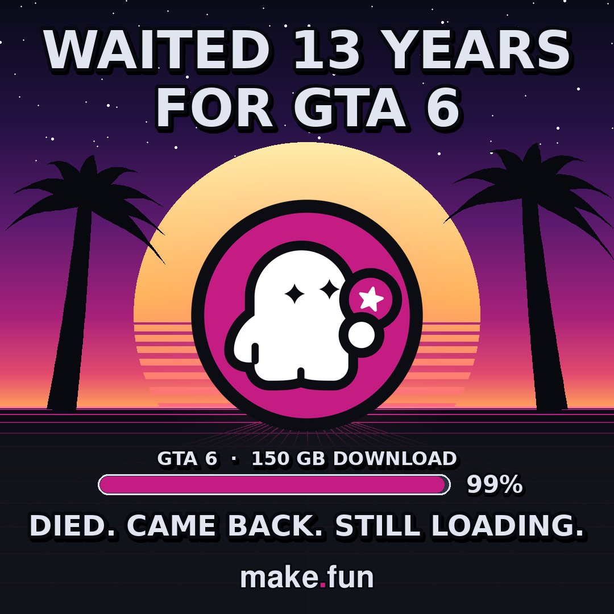

# GTA 6 launch-week meme — the ghost who waited 13 years

The joke in one line: a fan waited 13 years for GTA 6, died, came back as the
make.fun ghost — and the 150 GB download is still stuck at 99%.



## What's here
- `meme.png` — the entry, a square 1080×1080 PNG.
- `meme.py` — deterministic generator (pure Pillow, no network). The official
  make.fun ghost mark (`assets/mark-on-dark-1024.png`) is the main character,
  composited as-is into a Vice City synthwave sunset with a striped-sun halo,
  palm silhouettes, a neon grid, and a 99%-stuck loading bar.
- Caption in the image: "WAITED 13 YEARS FOR GTA 6" / "DIED. CAME BACK. STILL LOADING."
- `main.ts` — the graded harness (Node 22+, standard library only).
- `POST.json` — the live X post URL for this entry (posted 20 Nov 2026).

## Run the harness
```
mkdir -p out && MAKEFUN_BOT_DIR=. MAKEFUN_OUTPUT_DIR=out node main.ts
```
It copies `POST.json` into the output directory. Two runs write identical bytes.

## Regenerate the image
```
python3 meme.py
```

## Bounty
https://make.fun/bounty/gta6-meme-x-01

make.fun · gta6-meme-x-01
